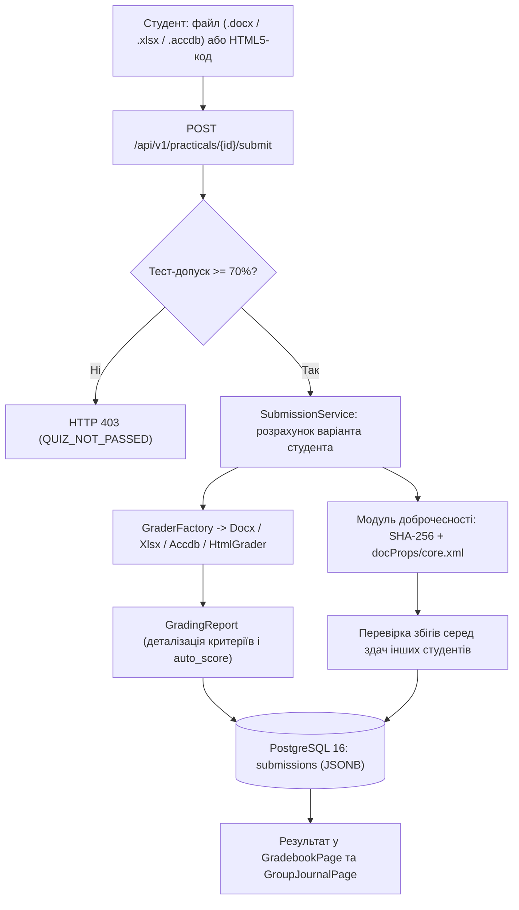

# Edu Auto Grader

[](https://www.python.org/)
[](https://fastapi.tiangolo.com/)
[](https://react.dev/)
[](https://www.typescriptlang.org/)
[](https://www.postgresql.org/)
[](https://www.docker.com/)

**Edu Auto Grader** — це спеціалізована вебсистема електронних навчально-методичних посібників із вбудованим ядром **100% детермінованої автоматизованої перевірки практичних робіт** із дисциплін **Microsoft Word (`.docx`)**, **Microsoft Excel (`.xlsx`)**, **Microsoft Access (`.accdb`)** та **HTML5**.

Система розроблена як інтерактивний практикум, що доповнює базову навчальну платформу коледжу **`kpefk.lcloud.in.ua`**. Вона закриває нішу миттєвої валідації файлів та HTML-коду за декларативними правилами, автоматичного розподілу індивідуальних варіантів і контролю академічної доброчесності. Обмін даними з `kpefk.lcloud.in.ua` відбувається автономно й безпечно — через експорт зведених відомостей успішності групи у форматах `.xlsx` та `.pdf` (без прямої API-інтеграції та без суб'єктивного LLM-оцінювання).

---

## Зміст

- [Ключові можливості системи](#ключові-можливості-системи)
- [Технологічний стек та архітектура](#технологічний-стек-та-архітектура)
- [Схема бази даних](#схема-бази-даних)
- [Швидкий старт (локальне розгортання)](#швидкий-старт-локальне-розгортання)
- [Демонстраційні облікові записи](#демонстраційні-облікові-записи)
- [Структура проєкту](#структура-проєкту)
- [Тестування та перевірка якості коду](#тестування-та-перевірка-якості-коду)

---

## Ключові можливості системи

### Рольова модель (JWT + RBAC)

#### Студент (`student`)
- **Навчальний кабінет і прогрес:** перегляд доступних курсів (`word`, `excel`, `access`, `html`), модулів і відсотка виконання програми (`CoursesPage`).
- **Теорія та тест-допуск:** вивчення Markdown/HTML-лекцій у `ModuleViewPage` та проходження тесту-допуску (прохідний поріг — **`>= 70%`**). Без успішного складання тесту доступ до ендпоінту здачі практичної роботи блокується на рівні бекенду (`HTTP 403`, код `QUIZ_NOT_PASSED`).
- **Індивідуальний варіант:** після допуску система детерміновано закріплює варіант студента за порядковим номером у журналі групи:
  `variant_index = ((student.list_number or 1) - 1) % total_variants` (в інтерфейсі відображається `variant_number = variant_index + 1`).
- **Здача робіт у 2 режимах:**
  - *Офісні файли (`.docx`, `.xlsx`, `.accdb`):* завантаження файлу через drag-and-drop форму (`multipart/form-data`).
  - *HTML5-пісочниця (`HtmlSandbox`):* написання коду у вбудованому редакторі **Monaco Editor** із миттєвим рендерингом в ізольованому `<iframe sandbox>` та надсиланням коду на серверну DOM-перевірку (`application/json`).
- **Електронна заліковка (`GradebookPage`):** історія всіх здач, деталізований розбір кожного критерію (`GradingReportCard`: очікуване vs фактичне значення, нараховані бали, текстове пояснення) та статус перевірки авторства.

#### Викладач (`teacher`)
- **Конструктор навчального контенту (`CourseEditorPage`):** створення й редагування курсів, модулів, текстів лекцій, питань тесту-допуску та методичних вказівок до практичних робіт.
- **Візуальний конструктор правил (`RuleBuilderPage`):** гнучке налаштування декларативних `JSONB`-правил оцінювання та ваги кожного критерію в балах (`PUT /api/v1/practicals/{practical_id}/rules`).
- **Електронний журнал групи (`GroupJournalPage`):** матриця оцінок студентів групи, аналітика типових помилок по критеріях, візуальні бейджі антиплагіату (`PlagiarismBadge`) і можливість ручного коригування `final_score` з коментарем викладача (`PATCH /api/v1/submissions/{submission_id}/grade`).
- **Експорт звітності:** формування та завантаження зведеної відомості успішності групи у форматах **`.xlsx`** (`openpyxl`) та **`.pdf`** (`fpdf2` із підтримкою кирилиці) для перенесення оцінок у `kpefk.lcloud.in.ua`.

#### Адміністратор (`admin`)
- **Керування користувачами (`AdminUsersPage`):** CRUD-операції над обліковими записами, призначення ролей (`student`, `teacher`, `admin`), пошук і фільтрація користувачів.
- **Довідник академічних груп:** створення, редагування та видалення груп (шифр, спеціальність, курс), а також керування порядковими номерами студентів у списку (`list_number`).

### Ядро детермінованої автоперевірки

Ядро перевірки реалізовано за патерном **Strategy**: усі парсери успадковують єдиний абстрактний клас `BaseGrader` (`backend/app/graders/base.py`), а фабрика `GraderFactory` (`backend/app/graders/factory.py`) обирає потрібну стратегію за форматом практичної роботи. Підтримуються числові умови (`>=`, `<=`, `==`, `!=`, `>`, `<`) та підстановка параметрів індивідуального варіанта `{param}` у полі `expected`.

| Формат | Парсер та бібліотека | Підтримувані типи правил (`GradingRuleType`) | Що перевіряється |
| :--- | :--- | :--- | :--- |
| **Word (`.docx`)** | `DocxGrader` (`python-docx`) | `docx_page_margins`, `docx_font`, `docx_line_spacing`, `docx_alignment`, `docx_table_exists`, `docx_list_exists` | Поля сторінки (мм), гарнітура й кегль шрифту, міжрядковий інтервал, вирівнювання абзаців, наявність таблиць і маркованих/нумерованих списків |
| **Excel (`.xlsx`)** | `XlsxGrader` (`openpyxl`) | `xlsx_formula`, `xlsx_value`, `xlsx_chart_exists` | Текст формул у цільових комірках (`data_only=False`), кешовані обчислені значення (`data_only=True`) та наявність діаграм на аркуші (`_charts`) |
| **Access (`.accdb`)** | `AccdbGrader` (`access-parser`, fallback на `mdb-schema` / `mdbtools` у Linux) | `accdb_table_exists`, `accdb_column_exists`, `accdb_column_type` | Наявність і кількість таблиць, існування стовпців (`Table.Column`) та відповідність їхніх типів даних схемі БД |
| **HTML5** | `HtmlGrader` (`beautifulsoup4` + `lxml`) | `html_tag_exists`, `html_tag_count`, `html_attribute_exists` | Валідація DOM-дерева за CSS-селекторами (`header > h1`, `table tr` тощо), підрахунок елементів та перевірка обов'язкових атрибутів |

### Модуль академічної доброчесності (`docProps/core.xml` + SHA-256)

Модуль реалізовано в `backend/app/graders/metadata.py` і він виконується автоматично під час кожної здачі:

1. **Криптографічний хеш SHA-256:**
   - для бінарних файлів (`.docx`, `.xlsx`, `.accdb`) обчислюється поблочний SHA-256 хеш вмісту;
   - для HTML5-коду виконується нормалізація пробільних символів перед обчисленням SHA-256.
2. **Екстракція метаданих OpenXML (`docProps/core.xml`):**
   - із ZIP-архівів `.docx` та `.xlsx` через `zipfile` та `xml.etree.ElementTree` вилучаються `creator`, `last_modified_by`, `created`, `modified` і `revision`.
3. **Детерміноване маркування плагіату:**
   - здача порівнюється з усіма попередніми роботами інших студентів за тією ж практичною роботою;
   - при виявленні збігу **SHA-256**, мітки часу **`created`** або пари **`(creator, modified)`** система автоматично виставляє `is_plagiarism_flagged = True` та зберігає обґрунтування у `plagiarism_reason`.

---

## Технологічний стек та архітектура

### Таблиця технологій

| Шар | Технології та версії | Призначення |
| :--- | :--- | :--- |
| **Backend API** | Python `3.12+`, FastAPI `0.115.6`, Uvicorn `0.32.1`, Pydantic `2.10.3`, `pydantic-settings` `2.6.1` | Асинхронний REST API (`/api/v1`), OpenAPI-документація, сувора валідація контрактів |
| **ORM та БД** | PostgreSQL `16` (`postgres:16-alpine`), SQLAlchemy `2.0.36` (async), `asyncpg` `0.30.0`, Alembic `1.13.3` | Реляційне зберігання даних, декларативні `JSONB`-структури, версіоновані міграції |
| **Безпека** | PyJWT `2.10.1`, `bcrypt` `4.2.0` | JWT-автентифікація (`access` + `refresh`), хешування паролів, RBAC-залежності |
| **Ядро парсерів** | `python-docx` `1.1.2`, `openpyxl` `3.1.5`, `access-parser` `0.0.6`, `beautifulsoup4` `4.12.3`, `lxml` `5.3.0` | Детермінований розбір `.docx`, `.xlsx`, `.accdb` та HTML5 DOM |
| **Експорт звітів** | `openpyxl` `3.1.5`, `fpdf2` `2.8.1` | Генерація відомостей успішності груп у `.xlsx` та `.pdf` |
| **Frontend** | Node.js `20 LTS`, React `18.3.1`, TypeScript `~5.6.3` (`strict: true`), Vite `5.4.11`, Tailwind CSS `3.4.15` | SPA-інтерфейс із рольовою навігацією та адаптивним UI |
| **UI та стан** | `@monaco-editor/react` `4.6.0`, TanStack Query `^5.60.0`, React Router `^6.28.0`, Axios `^1.7.7`, Lucide React `^0.460.0` | HTML5-пісочниця, кешування серверного стану, маршрутизація, JWT-інтерсептори |
| **Інфраструктура та QA** | Docker & Docker Compose, Ruff, Mypy (`--strict`), Pytest + `pytest-asyncio` + `httpx`, ESLint, `tsc --noEmit` | Контейнеризація БД, статичний аналіз, модульне та інтеграційне тестування |

### Потік здачі та автоматизованої перевірки роботи



### Ключові REST API маршрути (`/api/v1`)

Усі доменні помилки перехоплюються глобальним exception handler (`DomainError`) і повертають уніфікований JSON: `{"detail": str, "code": str, "context": dict}`.

| Метод | Маршрут | Доступ | Призначення |
| :--- | :--- | :--- | :--- |
| `POST` | `/api/v1/auth/login`, `/api/v1/auth/refresh` | Public | Отримання та оновлення JWT access/refresh токенів |
| `GET` | `/api/v1/auth/me` | Authenticated | Профіль поточного користувача |
| `GET` | `/api/v1/courses`, `/api/v1/modules/{module_id}` | Authenticated | Перелік курсів із прогресом, текст лекції та статус тесту-допуску |
| `POST` | `/api/v1/modules/{module_id}/quiz/submit` | Student | Перевірка відповідей тесту-допуску та розблокування практичної |
| `GET` | `/api/v1/practicals/{practical_id}` | Student | Умова та персональний варіант студента |
| `POST` | `/api/v1/practicals/{practical_id}/submit` | Student | Завантаження файлу (`multipart/form-data`) або HTML (`application/json`) і миттєва перевірка |
| `GET` | `/api/v1/submissions/me`, `/api/v1/submissions` | Student / Teacher | Заліковка студента та фільтрований список здач групи |
| `PUT` | `/api/v1/practicals/{practical_id}/rules` | Teacher / Admin | Оновлення `JSONB`-правил автоперевірки |
| `PATCH` | `/api/v1/submissions/{submission_id}/grade` | Teacher / Admin | Ручне коригування фінального бала та коментаря викладача |
| `GET` | `/api/v1/analytics/groups/{group_id}/journal` | Teacher / Admin | Зведений журнал групи та статистика помилок по критеріях |
| `GET` | `/api/v1/analytics/groups/{group_id}/export` | Teacher / Admin | Експорт відомості групи (`?format=xlsx` або `?format=pdf`) |
| `CRUD` | `/api/v1/admin/groups`, `/api/v1/admin/users` | Admin | Керування академічними групами та обліковими записами |

---

## Схема бази даних

База даних **PostgreSQL 16** складається з **8 реляційних таблиць** із `UUID` первинними ключами, типізованими `ENUM` (`user_role`, `course_slug`, `practical_format`) та полями `JSONB` для гнучкого зберігання варіантів, правил перевірки й звітів:

| № | Таблиця | Ключові стовпці та зв'язки | Призначення |
| :-: | :--- | :--- | :--- |
| 1 | `academic_groups` | `id`, `code` (UNIQUE), `specialty`, `course_year` | Довідник академічних груп коледжу (напр. `КН-31`) |
| 2 | `users` | `id`, `email` (UNIQUE), `password_hash`, `full_name`, `role` (ENUM), `group_id` (FK -> `academic_groups`, `SET NULL`), `list_number`, `created_at` | Облікові записи студентів, викладачів і адміністраторів |
| 3 | `courses` | `id`, `title`, `slug` (ENUM, UNIQUE), `description`, `teacher_id` (FK -> `users`) | Навчальні дисципліни (`word`, `excel`, `access`, `html`) |
| 4 | `modules` | `id`, `course_id` (FK -> `courses`, `CASCADE`), `order_index`, `title`, `lecture_content` | Тематичні модулі курсу з Markdown/HTML-лекціями |
| 5 | `quiz_questions` | `id`, `module_id` (FK -> `modules`, `CASCADE`), `question_text`, `options` (`JSONB`), `correct_option_index` | Питання тесту-допуску для кожного модуля |
| 6 | `quiz_attempts` | `id`, `student_id` (FK -> `users`, `CASCADE`), `module_id` (FK -> `modules`, `CASCADE`), `score_percent`, `passed`, `attempted_at` | Історія спроб складання тесту-допуску студентами |
| 7 | `practicals` | `id`, `module_id` (UNIQUE FK -> `modules`, `CASCADE`), `title`, `instructions`, `format_type` (ENUM), `max_score`, `variants` (`JSONB`), `grading_rules` (`JSONB`) | Практичні роботи, індивідуальні варіанти та декларативні правила |
| 8 | `submissions` | `id`, `practical_id` (FK), `student_id` (FK), `variant_index`, `file_path`, `raw_code`, `file_hash` (SHA-256, indexed), `extracted_metadata` (`JSONB`), `is_plagiarism_flagged`, `plagiarism_reason`, `auto_score`, `final_score`, `grading_report` (`JSONB`), `teacher_comment`, `submitted_at` | Здачі робіт, метадані антиплагіату, автоматичні й скориговані оцінки та звіти перевірки |

### Принцип декларативних `JSONB`-правил оцінювання

Критерії перевірки не зашиті в коді, а зберігаються у `practicals.grading_rules` як масив JSON-об'єктів, суворо валідований Pydantic-схемою `GradingRule` (`extra="forbid"`). Викладач може змінювати набір критеріїв і їхню вагу без перезбірки сервера, а ядро `BaseGrader` автоматично підставляє параметри варіанта (`{param}`) з `practicals.variants` і формує деталізований `GradingReport` у `submissions.grading_report`.

```json
[
  {
    "id": "excel_rule_1",
    "type": "xlsx_formula",
    "target": "D12",
    "expected": "SUM(D2:D11)",
    "points": 3.5,
    "description": "Використано функцію SUM для підрахунку підсумку в комірці D12"
  },
  {
    "id": "excel_rule_4",
    "type": "xlsx_chart_exists",
    "target": "Sheet1",
    "expected": "true",
    "points": 2.0,
    "description": "На аркуші Sheet1 побудовано діаграму"
  },
  {
    "id": "html_rule_3",
    "type": "html_tag_count",
    "target": "table tr",
    "expected": ">=4",
    "points": 3.0,
    "description": "Таблиця містить щонайменше 4 рядки (<tr>)"
  }
]
```

---

## Швидкий старт (локальне розгортання)

### Передумови
- **Python 3.12+**
- **Node.js 20 LTS** та **npm**
- **Docker** та **Docker Compose**
- *(Опційно, для Linux)* `mdbtools` як резервний CLI-парсер `.accdb` (основний кросплатформний парсер `access-parser` встановлюється автоматично з Python-залежностями)

### 1. Клонування репозиторію

```bash
git clone <URL_РЕПОЗИТОРІЮ> edu-auto-grader
cd edu-auto-grader
```

### 2. Налаштування змінних середовища (`.env`)

Створіть файл `.env` у корені проєкту (його використовують `docker-compose.yml` та `backend/app/core/config.py`):

```env
POSTGRES_USER=postgres
POSTGRES_PASSWORD=postgres
POSTGRES_HOST=localhost
POSTGRES_PORT=5432
POSTGRES_DB=edu_auto_grader

JWT_SECRET_KEY=change-me-in-production-super-secret-jwt-key-32b
JWT_ALGORITHM=HS256
ACCESS_TOKEN_EXPIRE_MINUTES=60
REFRESH_TOKEN_EXPIRE_DAYS=7

CORS_ORIGINS=["http://localhost:5173","http://127.0.0.1:5173"]
UPLOADS_DIR=uploads
QUIZ_PASS_THRESHOLD_PERCENT=70.0
```

### 3. Запуск PostgreSQL 16 через Docker Compose

```bash
docker compose up -d
docker compose ps
```

Зачекайте, доки контейнер `edu_auto_grader_db` перейде у статус `healthy` (перевіряється через `pg_isready`).

### 4. Налаштування Python-середовища та встановлення залежностей бекенду

**Windows (PowerShell):**
```powershell
python -m venv .venv
.\.venv\Scripts\Activate.ps1
pip install -e "./backend[dev]"
```

**Linux / macOS:**
```bash
python3.12 -m venv .venv
source .venv/bin/activate
pip install -e "./backend[dev]"
```

### 5. Застосування міграцій бази даних (Alembic)

```bash
alembic -c backend/alembic.ini upgrade head
```

### 6. Початкове наповнення бази даних (`seed.py`)

Скрипт `backend/app/seed.py` є ідемпотентним — створює академічну групу `КН-31`, 5 облікових записів та 4 готові курси (`word`, `excel`, `access`, `html`). Для попередньої перевірки без запису в БД підтримується прапорець `--dry-run`.

**Windows (PowerShell):**
```powershell
$env:PYTHONPATH="backend"
python -m app.seed
```

**Linux / macOS:**
```bash
PYTHONPATH=backend python -m app.seed
```

### 7. Запуск Backend (FastAPI + Uvicorn)

```bash
uvicorn app.main:app --app-dir backend --reload --host 0.0.0.0 --port 8000
```

- Інтерактивна Swagger-документація: `http://localhost:8000/docs`
- Перевірка стану сервісу: `http://localhost:8000/health`

### 8. Запуск Frontend (React + Vite)

В окремому вікні терміналу виконайте:

```bash
npm --prefix frontend install
npm --prefix frontend run dev
```

- Вебінтерфейс доступний за адресою: `http://localhost:5173`
- Vite автоматично проксує запити `/api/*` на `http://localhost:8000` (налаштовано у `frontend/vite.config.ts`).

---

## Демонстраційні облікові записи

Після виконання `python -m app.seed` у базі даних створюється група **`КН-31`** (*спеціальність «122 Комп'ютерні науки», 3 курс*), 4 курси (4 модулі, 20 тестових питань, 4 практичні роботи по 3 варіанти) та такі облікові записи:

| Роль | Email | Пароль | ПІБ | Група | Номер у списку / Варіант |
| :--- | :--- | :--- | :--- | :---: | :---: |
| `admin` | `admin@kpefk.lcloud.in.ua` | `Admin123!` | Адміністратор Системи | — | — |
| `teacher` | `teacher@kpefk.lcloud.in.ua` | `Teacher123!` | Коваленко Олександр Петрович | — | — |
| `student` | `student1@kpefk.lcloud.in.ua` | `Student123!` | Бондаренко Ірина Василівна | `КН-31` | №1 (Варіант 1) |
| `student` | `student2@kpefk.lcloud.in.ua` | `Student123!` | Мельник Дмитро Сергійович | `КН-31` | №2 (Варіант 2) |
| `student` | `student3@kpefk.lcloud.in.ua` | `Student123!` | Шевченко Максим Андрійович | `КН-31` | №3 (Варіант 3) |

---

## Структура проєкту

```text
edu-auto-grader/
├── AGENTS.md                           # Стандарти інженерної розробки (SDD)
├── ARCHITECTURE.md                     # Технічна архітектура та контракти
├── SPEC.md                             # Продуктова специфікація MVP
├── TASKS.md                            # План та статус виконання задач
├── docker-compose.yml                  # PostgreSQL 16 + volume uploads/
├── uploads/                            # Сховище завантажених робіт студентів
├── backend/
│   ├── pyproject.toml                  # Залежності Python, конфіги ruff/mypy/pytest
│   ├── alembic.ini                     # Конфігурація Alembic
│   ├── alembic/
│   │   ├── env.py                      # Асинхронний запуск міграцій
│   │   └── versions/
│   │       └── 0001_initial_schema.py  # Початкова міграція 8 таблиць БД
│   ├── app/
│   │   ├── main.py                     # Фабрика FastAPI, CORS, DomainError handler, /health
│   │   ├── seed.py                     # CLI-ініціалізація демо-групи, акаунтів та 4 курсів
│   │   ├── core/
│   │   │   ├── config.py               # Налаштування середовища (Pydantic BaseSettings)
│   │   │   ├── database.py             # AsyncEngine, AsyncSessionLocal, Base
│   │   │   ├── exceptions.py           # DomainError, GradingError, InvalidFileFormatError, PlagiarismDetectedError, QuizNotPassedError
│   │   │   └── security.py             # bcrypt-хешування паролів, PyJWT access/refresh
│   │   ├── models/
│   │   │   ├── user.py                 # AcademicGroup, User, UserRole
│   │   │   ├── course.py               # Course, Module, QuizQuestion, Practical
│   │   │   └── progress.py             # QuizAttempt, Submission
│   │   ├── schemas/
│   │   │   ├── auth.py                 # JWT, профілі користувачів та академічних груп
│   │   │   ├── course.py               # Курси, модулі, тести-допуски, варіанти
│   │   │   ├── grading.py              # GradingRuleType, GradingRule, CriterionResult, GradingReport
│   │   │   └── submission.py           # Здачі, ручне оцінювання, журнал групи, аналітика
│   │   ├── graders/
│   │   │   ├── base.py                 # Абстрактна стратегія BaseGrader
│   │   │   ├── factory.py              # GraderFactory (вибір парсера за форматом)
│   │   │   ├── metadata.py             # SHA-256 хешування, docProps/core.xml, антиплагіат
│   │   │   ├── docx_grader.py          # Парсер Microsoft Word (.docx)
│   │   │   ├── xlsx_grader.py          # Парсер Microsoft Excel (.xlsx)
│   │   │   ├── accdb_grader.py         # Парсер Microsoft Access (.accdb)
│   │   │   └── html_grader.py          # Валідатор HTML5 DOM (BeautifulSoup4)
│   │   ├── services/
│   │   │   ├── quiz_service.py         # Оцінювання тесту-допуску та розрахунок варіанта
│   │   │   ├── submission_service.py   # Оркестрація автоперевірки, антиплагіату та збереження
│   │   │   └── export_service.py       # Формування журналу групи та експорт .xlsx / .pdf
│   │   └── api/
│   │       ├── deps.py                 # Залежності get_db, get_current_user, require_role
│   │       └── v1/
│   │           ├── router.py           # Агрегація маршрутів /api/v1
│   │           ├── auth.py             # Автентифікація (/auth/*)
│   │           ├── courses.py          # Курси, модулі, тести, практичні
│   │           ├── practicals.py       # Здача робіт та оновлення правил оцінювання
│   │           ├── submissions.py      # Історія здач та ручне коригування оцінки
│   │           ├── analytics.py        # Журнал групи та експорт .xlsx / .pdf
│   │           └── admin.py            # Адміністрування груп і користувачів (/admin/*)
│   └── tests/
│       ├── conftest.py                 # Фікстури FastAPI AsyncClient та in-memory SQLite-адаптер
│       ├── test_graders.py             # Модульні тести Docx/Xlsx/Accdb/Html парсерів
│       ├── test_submissions_api.py     # Інтеграційні тести допуску, автоперевірки, антиплагіату й експорту
│       └── test_admin_api.py           # Тести RBAC та CRUD-операцій адміністратора
└── frontend/
    ├── package.json
    ├── tsconfig.json
    ├── vite.config.ts
    ├── tailwind.config.js
    ├── eslint.config.js
    └── src/
        ├── main.tsx
        ├── App.tsx                     # Маршрутизація та RoleGuard для 3 ролей
        ├── api/
        │   └── client.ts               # Axios-клієнт із JWT-інтерсепторами
        ├── context/
        │   └── AuthContext.tsx         # Контекст автентифікації та оновлення токенів
        ├── types/
        │   ├── api.ts                  # TypeScript-контракти користувачів, здач, журналу
        │   ├── course.ts               # Контракти курсів, модулів, тестів, практичних
        │   └── grading.ts              # Контракти правил і звітів автоперевірки
        ├── components/
        │   ├── layout/                 # Sidebar.tsx, Navbar.tsx, RoleGuard.tsx
        │   ├── sandbox/                # HtmlSandbox.tsx (Monaco Editor + iframe preview)
        │   └── grading/                # GradingReportCard.tsx, PlagiarismBadge.tsx
        └── pages/
            ├── LoginPage.tsx
            ├── student/                # CoursesPage.tsx, ModuleViewPage.tsx, GradebookPage.tsx
            ├── teacher/                # CourseEditorPage.tsx, RuleBuilderPage.tsx, GroupJournalPage.tsx
            └── admin/                  # AdminUsersPage.tsx
```

---

## Тестування та перевірка якості коду

### Backend (Python)

Набір тестів (18 модульних та інтеграційних тестів у `backend/tests/`) використовує in-memory SQLite-адаптер для `JSONB` у `conftest.py`, тому запускається автономно без вимоги до активного контейнера PostgreSQL.

```bash
# Лінтер та форматування (Ruff)
ruff check backend

# Сувора статична перевірка типів (Mypy strict)
mypy --strict backend/app

# Модульні та інтеграційні тести (Pytest)
pytest -c backend/pyproject.toml
```

### Frontend (TypeScript / React)

```bash
# Перевірка типів TypeScript (tsc --noEmit)
npm --prefix frontend run typecheck

# Статичний аналіз коду (ESLint)
npm --prefix frontend run lint

# Перевірка продакшен-збірки (TypeScript + Vite)
npm --prefix frontend run build
```

---

## Додаткова документація

- [SPEC.md](SPEC.md) — продуктова специфікація, ролі та функціональні вимоги MVP
- [ARCHITECTURE.md](ARCHITECTURE.md) — технічна архітектура, схема БД і контракти модулів
- [TASKS.md](TASKS.md) — покроковий журнал реалізації фаз проєкту
- [AGENTS.md](AGENTS.md) — інженерні стандарти та робочий цикл розробки
